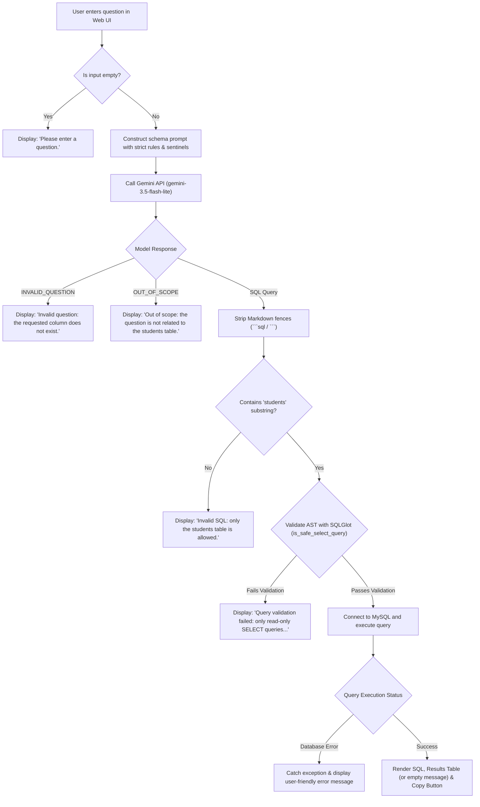

# Text-to-SQL: A Guardrailed Natural-Language Query Interface

> Ask a database questions in plain English. Get back validated, read-only SQL and live results, without trusting the LLM blindly.

A full-stack Python web application that converts natural-language questions into SQL queries using Google's Gemini API (`gemini-3.5-flash-lite`), verifies every generated query through deterministic Abstract Syntax Tree (AST) validation with **SQLGlot**, and executes permitted read-only queries against a **MySQL** database, rendering structured tabular results in an interactive web interface.

The core architectural philosophy: **the LLM proposes, the validator decides, the database enforces.** Three independent defensive layers ensure that no single failure—such as a prompt injection, model hallucination, or application bug—can compromise database integrity.

The reference implementation ships with a single `students` table, making the entire pipeline easy to read, test, and evaluate.

---

## Why This Project Exists

| Problem | Approach |
| :--- | :--- |
| **Non-technical users cannot write SQL** | Natural-language query interface with schema-aware prompting |
| **LLM-generated SQL is unsafe to run directly** | Deterministic AST security validation before execution |
| **Prompt-level constraints can be bypassed** | Defense-in-depth: AST validator plus a database-level `SELECT`-only user |
| **Hallucinated columns and off-topic requests** | Strict schema prompts with sentinel tokens (`INVALID_QUESTION`, `OUT_OF_SCOPE`) |

---

## Table of Contents

- [Project Overview](#project-overview)
- [How It Works](#how-it-works)
  - [Workflow Architecture](#workflow-architecture)
  - [Three Layers of Protection](#three-layers-of-protection)
- [Key Features](#key-features)
- [Technology Stack](#technology-stack)
- [Project Structure](#project-structure)
- [Prerequisites](#prerequisites)
- [Local Installation and Setup](#local-installation-and-setup)
- [Environment Variables](#environment-variables)
- [Database Setup](#database-setup)
  - [Schema Specification](#schema-specification)
  - [Principle of Least Privilege](#principle-of-least-privilege)
- [Example Questions & Outputs](#example-questions--outputs)
- [Security Architecture and AST Validation](#security-architecture-and-ast-validation)
  - [Validation Rules Summary](#validation-rules-summary)
  - [Detailed AST Checks](#detailed-ast-checks)
  - [Security Boundaries and Scope Limitations](#security-boundaries-and-scope-limitations)
- [Testing](#testing)
- [Architectural Flexibility & Plug-in Points](#architectural-flexibility--plug-in-points)
- [Deployment Preparation](#deployment-preparation)
  - [Runtime Environment](#1-runtime-environment)
  - [Database Connectivity and Networking](#2-database-connectivity-and-networking)
  - [Environment Variables and Cloud Secrets](#3-environment-variables-and-cloud-secrets)
  - [Production WSGI Server Configuration](#4-production-wsgi-server-configuration)
  - [Deployment Prerequisites Checklist](#5-deployment-prerequisites-checklist-unresolved-items)
- [Screenshots](#screenshots)
- [Roadmap and Future Enhancements](#roadmap-and-future-enhancements)
- [Contributing](#contributing)
- [Author and License](#author-and-license)

---

## Project Overview

Querying relational databases typically requires knowledge of SQL syntax, schema details, and table structures. This project allows users to ask questions in plain English (such as *"Show all students who scored more than 80 marks"* or *"Find students who live in Delhi"*) and receive verified results in real time.

The application processes user requests through a secure, defensive pipeline:
1. **Natural Language Translation**: The user's question is combined with schema constraints and sent to Google's Gemini API (`gemini-3.5-flash-lite`) to generate an appropriate SQL query.
2. **Deterministic AST Validation**: Before any query is executed, it is parsed into an Abstract Syntax Tree using `sqlglot`. The validator enforces strict rules: single statements only, `SELECT` operations only, explicit table and column whitelisting, and rejection of joins, unions, subqueries, and comments.
3. **Least-Privilege Database Execution**: Approved queries are executed against MySQL using a dedicated, read-only database user account.
4. **Interactive Web Interface**: The generated SQL, execution status, error messages, and tabular results are displayed in a clean, responsive Flask web UI with one-click clipboard copying.

---

## How It Works

### Workflow Architecture



### Three Layers of Protection

1. **Prompt Layer (LLM Guardrails)**: The model is instructed on the exact schema and given refusal directives, allowing it to return sentinel tokens (`INVALID_QUESTION`, `OUT_OF_SCOPE`) instead of guessing.
2. **Validation Layer (AST Analysis)**: `sqlglot` parses the SQL into an Abstract Syntax Tree and deterministically enforces security policies. This layer is independent of the model's behavior.
3. **Database Layer (Access Control)**: The application connects using a dedicated database user account granted strictly `SELECT` permissions on the `students` table.

---

## Key Features

- **Natural Language to SQL Generation**: Translates conversational questions into MySQL queries using Google's `gemini-3.5-flash-lite` model via the official `google-genai` SDK.
- **Prompt Guardrails and Sentinels**: Guides the LLM to return sentinel tokens (`INVALID_QUESTION` for non-existent columns, `OUT_OF_SCOPE` for unrelated queries) rather than hallucinating invalid queries.
- **AST-Based SQL Validation with SQLGlot**: Parses the generated SQL into an Abstract Syntax Tree using MySQL syntax rules, deterministically enforcing security policies before execution.
- **Strict Query Sanitization**:
  - Rejects SQL comments (`--`, `/*`, `*/`, `#`).
  - Requires exactly one SQL statement (prevents stacked query attacks).
  - Restricts operations strictly to `SELECT` (no `INSERT`, `UPDATE`, `DELETE`, `DROP`, `ALTER`, etc.).
  - Rejects `JOIN`, `UNION`, `INTERSECT`, `EXCEPT`, subqueries, and Common Table Expressions (CTEs).
  - Restricts execution exclusively to the `students` table.
  - Enforces a column whitelist (`id`, `name`, `age`, `marks`, `city`, and `*`).
  - Restricts functions to safe mathematical and aggregate operations (`COUNT`, `AVG`, `SUM`, `MIN`, `MAX`, `ROUND`).
- **MySQL Database Integration**: Executes validated queries via `mysql-connector-python` with automated connection cleanup in `finally` blocks.
- **Dynamic Tabular Result Rendering**: Extracts column headers directly from `cursor.description` and renders table rows dynamically. Displays *"No records found for this query."* if the result set is empty.
- **Real-Time UI Feedback**:
  - **Loading Indicator**: Displays an animated spinner and updates the submit button to *"Processing…"* while disabling it to prevent accidental duplicate submissions.
  - **State Retention**: Preserves the entered question in the textarea across submissions for fast iteration and query refinement.
  - **One-Click SQL Copying**: Copies the generated SQL to the clipboard via the modern Clipboard API, with an automatic selection fallback for unsupported environments.
- **Comprehensive Error Handling**: Safely catches and displays specific messages for empty queries, out-of-scope requests, AST validation failures, database errors, and Gemini API connectivity issues without terminating the application.

---

## Technology Stack

| Category | Technology / Library | Version / Specification | Role in Project |
| :--- | :--- | :--- | :--- |
| **Language** | Python | `3.10+` (tested on `3.13.0`) | Backend application runtime |
| **Web Framework** | Flask | `>=3.1.0` | Routing, request handling, and Jinja2 template rendering |
| **AI / LLM** | Google Gemini | `gemini-3.5-flash-lite` | Natural-language-to-SQL translation |
| **GenAI SDK** | `google-genai` | `>=2.0.0` | Official Python client library for Google Gemini |
| **SQL Parser & AST** | SQLGlot | `>=30.0.0` | Dialect-aware SQL parsing and AST security validation |
| **Database** | MySQL Server | `8.0+` | Relational database storage |
| **Database Driver** | `mysql-connector-python` | `>=8.0.0` | Python driver for executing queries against MySQL |
| **Environment Config** | `python-dotenv` | `>=1.0.0` | Loads secrets and configuration from `.env` |
| **Frontend** | HTML5, CSS3, Vanilla JS | Modern Browser Standards | User interface, loading states, table display, clipboard copy |
| **Version Control** | Git & GitHub | Standard | Source code version management |

---

## Project Structure

```text
Text-to-SQL-Project/
├── templates/
│   └── index.html          # Web frontend template (input form, loading state, SQL display, results table)
├── .env                    # Local environment variables and secrets (excluded from Git)
├── .env.example            # Template showing required configuration variables with placeholders
├── .gitignore              # Git ignore rules for virtual environments, caches, and secrets
├── app.py                  # Core Flask web application, Gemini integration, AST validator, and MySQL execution
├── geminiapitest.py        # Standalone verification script for Gemini API connectivity and responses
├── requirements.txt        # Python package dependencies
├── test_validator.py       # Automated test suite evaluating AST query validation rules
└── README.md               # Project documentation
```

---

## Prerequisites

Before setting up the project locally, ensure you have the following installed:

1. **Python 3.10 or higher** (Python 3.13 is fully tested and verified).
2. **MySQL Server 8.0 or higher** running locally or accessible across your network.
3. **Google Gemini API Key**: Obtain a free API key from [Google AI Studio](https://aistudio.google.com/).
4. **Git**: Installed and available in your terminal path.

---

## Local Installation and Setup

### 1. Clone the repository

```powershell
git clone https://github.com/om-saxena34/Text-to-SQL-Project.git
cd Text-to-SQL-Project
```

### 2. Create and activate a Python virtual environment

- **On Windows (PowerShell):**
  ```powershell
  python -m venv .venv
  .\.venv\Scripts\Activate.ps1
  ```

- **On Windows (Command Prompt):**
  ```cmd
  python -m venv .venv
  .venv\Scripts\activate.bat
  ```

- **On macOS / Linux:**
  ```bash
  python3 -m venv .venv
  source .venv/bin/activate
  ```

### 3. Install required dependencies

Install all project dependencies using `requirements.txt`:

```powershell
pip install -r requirements.txt
```

Alternatively, you can install the core packages directly:

```powershell
pip install flask google-genai mysql-connector-python python-dotenv sqlglot
```

### 4. Configure environment variables

Copy the `.env.example` file to create your local `.env` file:

- **On Windows (PowerShell):**
  ```powershell
  Copy-Item .env.example .env
  ```

- **On macOS / Linux:**
  ```bash
  cp .env.example .env
  ```

Open `.env` and configure your credentials using your actual values:

```env
GEMINI_API_KEY=your_gemini_api_key_here
DB_HOST=localhost
DB_USER=textsql_reader
DB_PASSWORD=your_mysql_password_here
DB_NAME=texttosql
```

> [!IMPORTANT]
> Never commit `.env` or any real API keys or database passwords to version control. The project's `.gitignore` file is configured to exclude `.env`.

### 5. Initialize the MySQL Database and Sample Table

Log in to your MySQL server using the root or an administrative account:

```powershell
mysql -u root -p
```

Execute the following SQL commands to create the database, the `students` table, sample data, and a restricted read-only user account:

```sql
-- 1. Create the database
CREATE DATABASE IF NOT EXISTS texttosql;
USE texttosql;

-- 2. Create the students table
CREATE TABLE IF NOT EXISTS students (
    id INT AUTO_INCREMENT PRIMARY KEY,
    name VARCHAR(100) NOT NULL,
    age INT,
    marks INT,
    city VARCHAR(100)
);

-- 3. Populate sample student records
INSERT INTO students (name, age, marks, city) VALUES
('Aarav Sharma', 20, 85, 'Delhi'),
('Diya Patel', 21, 92, 'Mumbai'),
('Rohan Gupta', 19, 78, 'Delhi'),
('Ananya Iyer', 22, 88, 'Bengaluru'),
('Kabir Singh', 20, 65, 'Pune'),
('Ishita Verma', 21, 95, 'Delhi'),
('Arjun Mehta', 23, 72, 'Mumbai');

-- 4. Create a restricted, read-only MySQL user (Defense-in-Depth)
CREATE USER IF NOT EXISTS 'textsql_reader'@'localhost' IDENTIFIED BY 'your_mysql_password_here';
GRANT SELECT ON texttosql.students TO 'textsql_reader'@'localhost';
FLUSH PRIVILEGES;
```

> [!NOTE]
> Replace `'your_mysql_password_here'` with a strong password of your choice, and ensure the same password is set for `DB_PASSWORD` in your `.env` file.

### 6. Run the Validation Tests

Before starting the web server, run the automated test suite to ensure the SQL validator is operating correctly:

```powershell
python test_validator.py
```

All test cases should run and show matching `Expected` and `Actual` outputs.

### 7. (Optional) Verify Gemini API Connectivity

Run the standalone Gemini connectivity script to verify that your API key is active and communicating with Google's servers:

```powershell
python geminiapitest.py
```

### 8. Start the Flask Application

Launch the local development server:

```powershell
python app.py
```

You should see terminal output indicating that the application is running:

```text
 * Serving Flask app 'app'
 * Debug mode: on
 * Running on http://127.0.0.1:5000
```

Open `http://127.0.0.1:5000` in your web browser to access the application.

---

## Environment Variables

The application relies on the following environment variables, loaded automatically at runtime via `python-dotenv`:

| Variable Name | Required | Default / Example Value | Description |
| :--- | :---: | :--- | :--- |
| `GEMINI_API_KEY` | Yes | `your_gemini_api_key_here` | API key used by the `google-genai` SDK to authenticate with Google Gemini |
| `DB_HOST` | Yes | `localhost` | Hostname or IP address of the MySQL database server |
| `DB_NAME` | Yes | `texttosql` | Name of the database schema containing the `students` table |
| `DB_USER` | Yes | `textsql_reader` | MySQL user account (recommended: restricted read-only account) |
| `DB_PASSWORD` | Yes | `your_mysql_password_here` | Password for the MySQL user account |

---

## Database Setup

### Schema Specification

The application is designed to operate against a single table, `students`, defined as follows:

| Column Name | Data Type | Key / Constraint | Description |
| :--- | :--- | :--- | :--- |
| `id` | `INT` | `PRIMARY KEY`, `AUTO_INCREMENT` | Unique identifier for the student |
| `name` | `VARCHAR(100)` | `NOT NULL` | Full name of the student |
| `age` | `INT` | Nullable | Age of the student |
| `marks` | `INT` | Nullable | Academic marks/percentage |
| `city` | `VARCHAR(100)` | Nullable | City of residence |

### Principle of Least Privilege

Instead of connecting to MySQL using an administrative account such as `root`, this project implements a **least-privilege user architecture**:
- The application connects using `textsql_reader`.
- This user is granted **strictly `SELECT` permissions** on the `students` table (`GRANT SELECT ON texttosql.students TO ...`).
- Any attempt to modify, drop, truncate, or alter tables—even if somehow bypassed at the application layer—is strictly rejected by the MySQL database engine itself.

---

## Example Questions & Outputs

| Natural Language Question | Generated SQL Query | Query Status / Execution Result |
| :--- | :--- | :--- |
| *"Show all students whose marks are greater than 80"* | `SELECT * FROM students WHERE marks > 80;` | Approved & Executed (returns matching rows) |
| *"Find students who live in Delhi"* | `SELECT * FROM students WHERE city = 'Delhi';` | Approved & Executed (returns Delhi records) |
| *"Count the total number of students"* | `SELECT COUNT(*) FROM students;` | Approved & Executed (returns total count) |
| *"Show the average marks of students"* | `SELECT AVG(marks) FROM students;` | Approved & Executed (returns numeric average) |
| *"Show students sorted by marks descending"* | `SELECT * FROM students ORDER BY marks DESC;` | Approved & Executed (returns ordered rows) |
| *"Show students with their phone numbers"* | `INVALID_QUESTION` | Rejected at LLM stage (requested column does not exist) |
| *"What is the weather in Delhi?"* | `OUT_OF_SCOPE` | Rejected at LLM stage (question unrelated to students table) |

---

## Security Architecture and AST Validation

Allowing an AI model to generate SQL dynamically that executes against a live database introduces security concerns such as SQL injection, data alteration, denial of service, and cross-database data exfiltration.

To mitigate these risks, the application implements a multi-layered defense model:

### Validation Rules Summary

`is_safe_select_query(query)` in `app.py` enforces these deterministic checks:

| # | Security Rule | Threat / Pattern Blocked |
| :-: | :--- | :--- |
| **1** | No comments (`--`, `/* */`, `#`) | Comment-based query truncation or bypass tricks |
| **2** | Exactly one statement | Stacked queries (`SELECT ...; DROP TABLE ...`) |
| **3** | Root AST node must be `SELECT` | `INSERT`, `UPDATE`, `DELETE`, `DROP`, `ALTER`, `TRUNCATE` |
| **4** | No `JOIN`, `UNION`, `INTERSECT`, `EXCEPT` | Cross-table access and union-based data exfiltration |
| **5** | No subqueries or CTEs (`WITH`) | Nested query complexity and unauthorized table reads |
| **6** | Table allow-list (`students`) | Access to any non-approved database table |
| **7** | Column allow-list (`id`, `name`, `age`, `marks`, `city`, `*`) | Non-existent, sensitive, or qualified alias columns |
| **8** | Function allow-list (`COUNT`, `AVG`, `SUM`, `MIN`, `MAX`, `ROUND`) | Dangerous functions (`SLEEP()`, `BENCHMARK()`, `LOAD_FILE()`, `USER()`) |

### Detailed AST Checks

Rather than relying on fragile regular expressions or keyword blacklists, `is_safe_select_query(query)` parses the query into a syntax tree using `sqlglot` under MySQL syntax rules:

1. **Comment Rejection**: Rejects any query containing `--`, `/*`, `*/`, or `#`.
2. **Single-Statement Rule**: Parses the string via `sqlglot.parse(cleaned, read="mysql")` and requires `len(statements) == 1`. Queries containing stacked statements are blocked.
3. **Select-Only Statements**: Verifies that the root AST node is strictly an instance of `sqlglot.expressions.Select`.
4. **No Joins, Unions, or Set Operations**: Checks `tree.find(exp.Join)` and `tree.find(exp.Union)`. Cross-table joins and union-based exfiltration are strictly prohibited.
5. **No Subqueries or CTEs**: Checks `tree.find(exp.Subquery)` and `tree.find(exp.CTE)`. Nested queries and common table expressions are disallowed.
6. **Table Whitelisting**: Extracts all `exp.Table` nodes and verifies that every referenced table matches `"students"`.
7. **Column Whitelisting**: Inspects all `exp.Column` nodes and ensures every column belongs to `{"id", "name", "age", "marks", "city"}` (or wildcard `*`). Rejects unrecognized columns and qualified column references pointing to unapproved table aliases.
8. **Function Whitelisting**: Inspects all `exp.Func` nodes and strictly allows only safe mathematical and aggregate functions: `COUNT`, `AVG`, `SUM`, `MIN`, `MAX`, and `ROUND`. Dangerous functions (such as `SLEEP()`, `BENCHMARK()`, `LOAD_FILE()`, `USER()`, `DATABASE()`) are blocked.
9. **Fail-Safe Exception Handling**: Any syntax error, parsing ambiguity, or traversal failure causes `is_safe_select_query()` to safely return `False`.

### Security Boundaries and Scope Limitations

- **Defense-in-Depth, Not a Silver Bullet**: While AST parsing provides strong protection against SQL injection and unwanted operations, dynamic SQL generation requires defense-in-depth. Application validation should always be paired with database least privilege.
- **Single-Table Restriction**: Queries attempting to reference other tables or perform joins across tables are intentionally rejected.
- **Table Aliases Disallowed**: Standard table aliases (such as `SELECT s.name FROM students s`) are currently rejected by the validator because the column qualifier check requires direct matching with `"students"`.
- **Subqueries Disallowed**: Even benign single-table subqueries (such as `WHERE marks > (SELECT AVG(marks) FROM students)`) are rejected by design.
- **Unbounded Result Sets**: The current implementation does not automatically append an enforced `LIMIT` clause to generated queries.

---

## Testing

The project includes an automated test script, `test_validator.py`, which validates `is_safe_select_query()` against a comprehensive suite of legitimate, malicious, and out-of-scope query patterns without needing an active database connection.

### Running the Test Suite

Activate your virtual environment and execute:

```powershell
python test_validator.py
```

### Verified Test Cases

The test suite evaluates 20 test cases covering various security categories:

| Query Tested | Expected | Validation Outcome | Rule / Threat Mitigated |
| :--- | :---: | :---: | :--- |
| `SELECT * FROM students` | `True` | Approved | Allowed: Wildcard query on `students` table |
| `SELECT name FROM students WHERE marks > 80` | `True` | Approved | Allowed: Whitelisted column with numeric filter |
| `SELECT COUNT(*) FROM students` | `True` | Approved | Allowed: Whitelisted aggregate function and wildcard |
| `SELECT name FROM students JOIN users ON 1=1` | `False` | Rejected | Blocked: `JOIN` expressions are forbidden |
| `SELECT name FROM students UNION SELECT name FROM users` | `False` | Rejected | Blocked: `UNION` operations are forbidden |
| `SELECT salary FROM students` | `False` | Rejected | Blocked: `salary` is not in the column whitelist |
| `DELETE FROM students` | `False` | Rejected | Blocked: Data modification (`DELETE`) is forbidden |
| `SELECT name FROM students; SELECT name FROM users` | `False` | Rejected | Blocked: Stacked / multi-statement queries are forbidden |
| `SELECT name FROM students WHERE city = 'Delhi'` | `True` | Approved | Allowed: Permitted column with string filter |
| `SELECT SLEEP(5) FROM students` | `False` | Rejected | Blocked: `SLEEP` is not an approved function (DoS prevention) |
| `SELECT name FROM users` | `False` | Rejected | Blocked: Query targets an unauthorized table (`users`) |
| `SELECT name FROM students WHERE id = 1 -- comment` | `False` | Rejected | Blocked: SQL line comments (`--`) are forbidden |
| `SELECT s.name FROM students s` | `False` | Rejected | Blocked: Table alias `s` is not permitted |
| `SELECT name FROM students WHERE id IN (SELECT id FROM students)` | `False` | Rejected | Blocked: Subqueries are forbidden |
| `SELECT name FROM students -- comment` | `False` | Rejected | Blocked: SQL comments are forbidden |
| `SELECT name FROM students WHERE marks > 80; DELETE FROM students` | `False` | Rejected | Blocked: Stacked statement injection attempt |

---

## Architectural Flexibility & Plug-in Points

The validator is driven by allow-lists, so extending it to new domains involves updating configuration rather than rewriting core parsing logic.

### 1. Centralized Schema Definition

In future iterations, the schema can be centralized into a configuration object shared by both the prompt builder and the validator:

```python
SCHEMA = {
    "students": {"columns": ["id", "name", "age", "marks", "city"]},
    # "courses": {"columns": ["id", "title", "credits"]},
}
ALLOWED_FUNCTIONS = {"COUNT", "AVG", "SUM", "MIN", "MAX", "ROUND"}
MAX_ROWS = 50
```

### 2. Environment-Driven Configuration

Key settings can be externalized to environment variables:

```env
GEMINI_MODEL=gemini-3.5-flash-lite
MAX_ROWS=50
ALLOWED_TABLES=students
```

### 3. Plug-in Extension Guide

| Extension Goal | Implementation Steps |
| :--- | :--- |
| **Query another table** | Add table to schema configuration, update prompt, and execute `GRANT SELECT` in MySQL |
| **Use a different Gemini model** | Update `GEMINI_MODEL` in configuration / environment |
| **Allow additional functions** | Safely add deterministic functions (`DISTINCT`, `LOWER`, `UPPER`) to `ALLOWED_FUNCTIONS` |
| **Cap query result size** | Automatically append `LIMIT MAX_ROWS` to approved AST queries |
| **Allow table aliases (`students s`)** | Resolve and unwrap table aliases in the AST validator before checking column permissions |
| **Allow safe subqueries** | Permit `exp.Subquery` only when internal targets strictly match the approved schema |
| **Support multi-table joins** | Define explicit whitelist of approved table pairs and primary/foreign join keys |
| **Switch database engines** | Change the SQLGlot dialect (`read="postgres"`, etc.) and the corresponding database driver |

---

## Deployment Preparation

Preparing this application for production deployment requires several adjustments beyond local development. The following sections outline the infrastructure and configuration requirements.

### 1. Runtime Environment
- The hosting platform (e.g., Render, Railway, Fly.io, AWS, Heroku) must support a Python 3 runtime environment.
- Dependencies listed in `requirements.txt` will be installed during the build step.

### 2. Database Connectivity and Networking
- **`localhost` Is Not Reachable From Cloud Hosts**: A MySQL server running locally on your computer at `localhost` or `127.0.0.1` will not be accessible to a cloud-hosted application.
- **Hosted MySQL Instance Required**: You must provision a cloud-hosted MySQL database (such as AWS RDS, Aiven, PlanetScale, or a managed MySQL database provided by your hosting platform).
- **Network and Firewall Configuration**: Ensure the cloud MySQL instance allows incoming connections from your application service (via IP allowlisting, VPC peering, or public accessibility with SSL/TLS).
- **Restricted Database User**: Re-create the restricted `textsql_reader` user on your cloud database instance, ensuring permissions are scoped appropriately (e.g., `'textsql_reader'@'%'` or bound to specific subnets).

### 3. Environment Variables and Cloud Secrets
- Cloud hosting providers do not use local `.env` files. You must enter your environment variables directly into the hosting platform's dashboard or secrets manager:
  - `GEMINI_API_KEY`
  - `DB_HOST`
  - `DB_USER`
  - `DB_PASSWORD`
  - `DB_NAME`

### 4. Production WSGI Server Configuration
- In `app.py`, the application currently ends with:
  ```python
  if __name__ == "__main__":
      app.run(debug=True)
  ```
- **Warning**: Flask's built-in development server (`app.run()`) with `debug=True` is **not production-safe**. In production:
  - `debug=True` enables interactive tracebacks, which could expose sensitive system internals.
  - The development server is single-threaded and not designed for concurrent production traffic.
- **Recommended Action**: For production deployment, use a battle-tested WSGI HTTP server:
  - On Linux/Cloud Containers: **Gunicorn** (`pip install gunicorn`)
    ```bash
    gunicorn -w 2 -b 0.0.0.0:$PORT app:app
    ```
  - On Windows: **Waitress** (`pip install waitress`)
    ```bash
    waitress-serve --port=5000 app:app
    ```

### 5. Deployment Prerequisites Checklist (Unresolved Items)

Before going live, complete the following steps:
- [ ] Provision a reachable cloud MySQL database instance.
- [ ] Initialize the schema (`CREATE TABLE students ...`) and insert initial records on the cloud database.
- [ ] Create a restricted read-only MySQL user on the cloud database.
- [ ] Add `gunicorn` to `requirements.txt` if deploying to a Linux-based cloud environment.
- [ ] Configure the hosting service's startup command (e.g., `gunicorn app:app`).
- [ ] Configure the 5 required environment variables in your hosting provider's dashboard.
- [ ] Verify SSL/TLS connectivity between Flask and the cloud MySQL database.

> [!NOTE]
> The application has not yet been deployed to a public URL. The instructions above prepare the repository for when you are ready to choose and configure a hosting platform.

---

## Screenshots

<!-- TODO: Add application screenshots here once captured. -->
> *UI screenshots will be added here showcasing the natural language input form, the dynamic loading state, the generated SQL output, and the tabular query results.*

Recommended screenshot placements:
- `docs/screenshots/app_interface.png` — Main query submission interface
- `docs/screenshots/query_results.png` — Generated SQL and tabular query results
- `docs/screenshots/validation_error.png` — AST validation rejection feedback

---

## Roadmap and Future Enhancements

- [ ] **Production WSGI Server Setup**: Add `gunicorn` configuration and build scripts for container and cloud deployments.
- [ ] **Query Result Pagination**: Enforce a default row limit (e.g., `LIMIT 50`) to prevent memory exhaustion on large datasets.
- [ ] **Table Alias Support**: Update the AST validator to resolve table aliases (e.g., `FROM students s`) while maintaining table isolation.
- [ ] **Safe Subquery Evaluation**: Support single-table subqueries on the `students` table (e.g., comparisons against `AVG(marks)`).
- [ ] **Containerization**: Provide a `Dockerfile` and `docker-compose.yml` to spin up the Flask application and MySQL database in a single command.
- [ ] **Multi-Table Relational Queries**: Expand schema support to multiple related tables with approved `INNER JOIN` patterns.
- [ ] **Query History and Rate Limiting**: Store user query history and apply rate limits on Gemini API requests.

---

## Contributing

Contributions, issues, and feature requests are welcome!

1. Fork the repository.
2. Create a feature branch: `git checkout -b feature/your-feature-name`.
3. Make your changes and verify existing tests: `python test_validator.py`.
4. Commit your changes: `git commit -m "Add descriptive commit message"`.
5. Push to your branch: `git push origin feature/your-feature-name`.
6. Open a Pull Request.

---

## Author and License

**Om Saxena**
- GitHub: [@om-saxena34](https://github.com/om-saxena34)
- Repository: [om-saxena34/Text-to-SQL-Project](https://github.com/om-saxena34/Text-to-SQL-Project)
