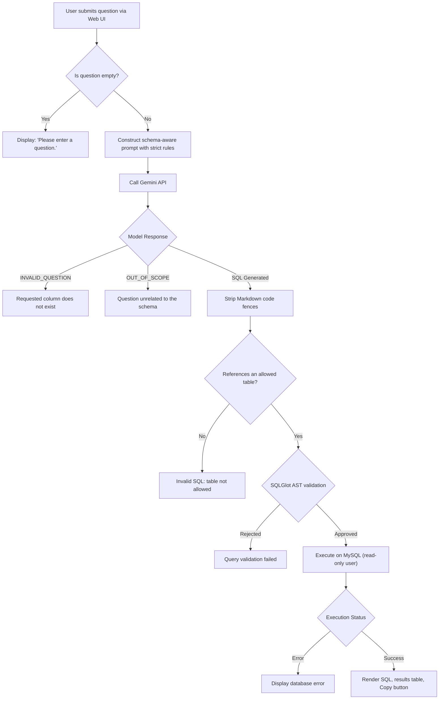

# Text-to-SQL: A Guardrailed Natural-Language Query Interface
 
> Ask a database questions in plain English. Get back validated, read-only SQL and live results, without trusting the LLM blindly.
 
A Flask web app that turns natural-language questions into SQL with Google Gemini, then **verifies every generated query with a deterministic SQLGlot AST validator** and a **least-privilege MySQL account** before anything touches the database.
 
The core idea: *the LLM proposes, the validator decides, the database enforces.* Three independent layers, so no single failure (a bad prompt, a clever injection, a model hallucination) can cause damage.
 
The reference implementation ships with a single `students` table, so the whole pipeline is easy to read, test and demo. The validation layer is built around a schema allow-list, so it can be pointed at other tables and columns (see [Making It Flexible](#making-it-flexible)).
 
---
 
## Why This Project Exists
 
| Problem | Approach |
| :--- | :--- |
| Non-technical users can't write SQL | Natural-language input, schema-aware prompting |
| LLM-generated SQL is unsafe to run directly | Deterministic AST validation before execution |
| Prompt-level rules can be bypassed | Defense-in-depth: validator and DB-level `SELECT`-only user |
| Hallucinated columns and off-topic questions | Sentinel tokens (`INVALID_QUESTION`, `OUT_OF_SCOPE`) |
 
---
 
## How It Works
 

 
**Three layers of protection**
 
1. **Prompt layer:** the model is told the schema and the rules, and can refuse via sentinel tokens.
2. **Validation layer:** SQLGlot parses the output into an AST and enforces hard rules (below). This layer is deterministic and does not depend on the model behaving.
3. **Database layer:** the app connects as a user that only has `SELECT` on the target table(s).
---
 
## Key Features
 
- **Natural language to SQL** via `google-genai` and Gemini (`gemini-3.5-flash-lite` by default).
- **Schema-aware prompting** with sentinel tokens for invalid or out-of-scope questions.
- **AST-based validation** with SQLGlot, using MySQL dialect rules.
- **Read-only execution** through `mysql-connector-python`.
- **Dynamic results table** built from `cursor.description`, with a clear empty-state message.
- **One-click Copy SQL** button (vanilla JavaScript, Clipboard API).
- **State preservation:** your question stays in the textarea so you can refine it.
- **Graceful error handling** for empty input, API failures, validation rejections and database errors.
---
 
## Validation Rules
 
`is_safe_select_query(query)` in `app.py` applies these checks:
 
| # | Rule | Blocks |
| :-: | :--- | :--- |
| 1 | No comments (`--`, `/* */`, `#`) | Comment-based truncation tricks |
| 2 | Exactly one statement | Stacked queries (`...; DROP ...`) |
| 3 | Root node must be `SELECT` | `INSERT`, `UPDATE`, `DELETE`, `DROP`, `ALTER`, `TRUNCATE` |
| 4 | No `JOIN` / `UNION` / `INTERSECT` / `EXCEPT` | Cross-table access and UNION exfiltration |
| 5 | No subqueries or CTEs | Nested and hidden queries |
| 6 | Table allow-list | Access to any non-approved table |
| 7 | Column allow-list (`id`, `name`, `age`, `marks`, `city`, `*`) | Hallucinated or sensitive columns |
| 8 | Function allow-list (`COUNT`, `AVG`, `SUM`, `MIN`, `MAX`, `ROUND`) | `SLEEP()`, `BENCHMARK()`, `LOAD_FILE()`, `USER()` |
 
> [!WARNING]
> These controls greatly reduce the attack surface, but no dynamic SQL system is 100% immune. This project is scoped as a single-table educational prototype, so review the rules before adapting it to real data.
 
---
 
## Quick Start
 
**Prerequisites:** Python 3.10+ (3.12 recommended), MySQL 8.0+, a [Gemini API key](https://aistudio.google.com/), Git.
 
```bash
# 1. Clone
git clone https://github.com/om-saxena34/Text-to-SQL-Project.git
cd Text-to-SQL-Project
 
# 2. Virtual environment
python -m venv .venv
source .venv/bin/activate        # macOS/Linux
# .\.venv\Scripts\Activate.ps1   # Windows PowerShell
 
# 3. Dependencies
pip install flask google-genai mysql-connector-python python-dotenv sqlglot
```
 
**4. Configure `.env`** (never commit this file; it is already gitignored):
 
```env
GEMINI_API_KEY=your_gemini_api_key_here
DB_HOST=localhost
DB_NAME=texttosql
DB_USER=textsql_reader
DB_PASSWORD=your_mysql_password_here
```
 
| Variable | Required | Purpose |
| :--- | :-: | :--- |
| `GEMINI_API_KEY` | Yes | Access to Gemini models |
| `DB_HOST` | Yes | MySQL host |
| `DB_NAME` | Yes | Database containing the target table |
| `DB_USER` | Yes | MySQL user (use a read-only account) |
| `DB_PASSWORD` | Yes | Password for that user |
 
**5. Set up the database:**
 
```sql
CREATE DATABASE IF NOT EXISTS texttosql;
USE texttosql;
 
CREATE TABLE IF NOT EXISTS students (
    id INT AUTO_INCREMENT PRIMARY KEY,
    name VARCHAR(100) NOT NULL,
    age INT,
    marks INT,
    city VARCHAR(100)
);
 
INSERT INTO students (name, age, marks, city) VALUES
('Aarav Sharma', 20, 85, 'Delhi'),
('Diya Patel', 21, 92, 'Mumbai'),
('Rohan Gupta', 19, 78, 'Delhi'),
('Ananya Iyer', 22, 88, 'Bengaluru'),
('Kabir Singh', 20, 65, 'Pune'),
('Ishita Verma', 21, 95, 'Delhi'),
('Arjun Mehta', 23, 72, 'Mumbai');
 
-- Least-privilege user (defense-in-depth)
CREATE USER IF NOT EXISTS 'textsql_reader'@'localhost' IDENTIFIED BY 'your_mysql_password_here';
GRANT SELECT ON texttosql.students TO 'textsql_reader'@'localhost';
FLUSH PRIVILEGES;
```
 
**6. Run it:**
 
```bash
python geminiapitest.py   # optional: verify your API key
python app.py             # starts http://127.0.0.1:5000
```
 
Open `http://127.0.0.1:5000`, type a question, click **Convert to SQL**.
 
---
 
## Example Questions
 
| Question | Generated SQL | Outcome |
| :--- | :--- | :--- |
| "Show all students whose marks are greater than 80" | `SELECT * FROM students WHERE marks > 80;` | Executed |
| "Find students who live in Delhi" | `SELECT * FROM students WHERE city = 'Delhi';` | Executed |
| "Count the total number of students" | `SELECT COUNT(*) FROM students;` | Executed |
| "Show the average marks of students" | `SELECT AVG(marks) FROM students;` | Executed |
| "Show students sorted by marks descending" | `SELECT * FROM students ORDER BY marks DESC;` | Executed |
| "Show students with their phone numbers" | `INVALID_QUESTION` | Rejected by LLM (no such column) |
| "What is the weather in Delhi?" | `OUT_OF_SCOPE` | Rejected by LLM (unrelated) |
 
---
 
## Making It Flexible
 
The validator is driven by allow-lists, so adapting it means changing configuration rather than rewriting logic. The reference implementation hardcodes these values; the design below is the recommended way to lift them into config.
 
**1. Move the schema into one config object** and let the prompt builder and validator both read from it:
 
```python
SCHEMA = {
    "students": {"columns": ["id", "name", "age", "marks", "city"]},
    # "courses": {"columns": ["id", "title", "credits"]},
}
ALLOWED_FUNCTIONS = {"COUNT", "AVG", "SUM", "MIN", "MAX", "ROUND"}
MAX_ROWS = 50
```
 
**2. Make the model and limits environment-driven:**
 
```env
GEMINI_MODEL=gemini-3.5-flash-lite
MAX_ROWS=50
ALLOWED_TABLES=students
```
 
**3. Plug-in points**
 
| Want to... | Change |
| :--- | :--- |
| Query another table | Add it to `SCHEMA`, add `GRANT SELECT` for it, update the prompt |
| Use a different Gemini model | Set `GEMINI_MODEL` |
| Allow more functions (`DISTINCT`, `LOWER`, ...) | Extend `ALLOWED_FUNCTIONS` |
| Cap result size | Append `LIMIT MAX_ROWS` to approved queries |
| Allow aliases (`students s`) | Resolve aliases in the validator before the column check |
| Allow safe subqueries | Permit `exp.Subquery` only when it targets an allowed table |
| Support joins | Whitelist specific table pairs and join keys |
| Use another database | Change the SQLGlot `read=` dialect and the driver |
 
---
 
## Testing
 
`test_validator.py` checks the validator without needing a database:
 
```bash
python test_validator.py
```
 
| Query | Expected | Rule |
| :--- | :-: | :--- |
| `SELECT * FROM students` | Allow | Wildcard on allowed table |
| `SELECT name FROM students WHERE marks > 80` | Allow | Allowed column, numeric filter |
| `SELECT COUNT(*) FROM students` | Allow | Whitelisted aggregate |
| `SELECT name FROM students WHERE city = 'Delhi'` | Allow | String filter |
| `SELECT name FROM students JOIN users ON 1=1` | Block | `JOIN` forbidden |
| `SELECT name FROM students UNION SELECT name FROM users` | Block | `UNION` forbidden |
| `SELECT salary FROM students` | Block | Column not allowed |
| `DELETE FROM students` | Block | Non-`SELECT` |
| `SELECT name FROM students; SELECT name FROM users` | Block | Stacked statements |
| `SELECT SLEEP(5) FROM students` | Block | Function not allowed |
| `SELECT name FROM users` | Block | Table not allowed |
| `SELECT name FROM students WHERE id = 1 -- comment` | Block | Comments forbidden |
| `SELECT s.name FROM students s` | Block | Aliases unsupported (current limitation) |
 
---
 
## Project Structure
 
```text
Text-to-SQL-Project/
├── templates/
│   └── index.html          # Frontend: form, SQL display, results table
├── .env                    # Local secrets (gitignored)
├── .gitignore
├── app.py                  # Flask app, Gemini call, SQLGlot validator, DB execution
├── geminiapitest.py        # Gemini connectivity check
├── test_validator.py       # Validator test suite
└── README.md
```
 
## Tech Stack
 
| Layer | Technology |
| :--- | :--- |
| Backend | Python 3, Flask 3 |
| LLM | Google Gemini API via `google-genai` |
| SQL parsing | SQLGlot |
| Database | MySQL 8 with `mysql-connector-python` |
| Config | `python-dotenv` |
| Frontend | HTML5, CSS, vanilla JavaScript |
 
---
 
## Known Limitations and Roadmap
 
**Current limitations:** single-table scope, no table aliases, no subqueries (even safe ones like `marks > (SELECT AVG(marks) ...)`), no automatic `LIMIT`, development server only, no authentication or query history.
 
**Roadmap**
 
- [ ] Config-driven schema, model and limits (see above)
- [ ] Alias resolution in the validator
- [ ] Safe single-table subqueries
- [ ] Default `LIMIT` and pagination
- [ ] Approved multi-table joins
- [ ] Production deployment (Gunicorn or Waitress, Docker)
- [ ] Query history and rate limiting
---
 
## Author
 
**Om Saxena**: [@om-saxena34](https://github.com/om-saxena34) · [Text-to-SQL-Project](https://github.com/om-saxena34/Text-to-SQL-Project)
